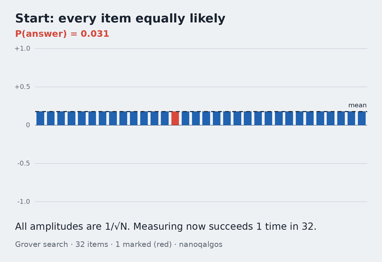
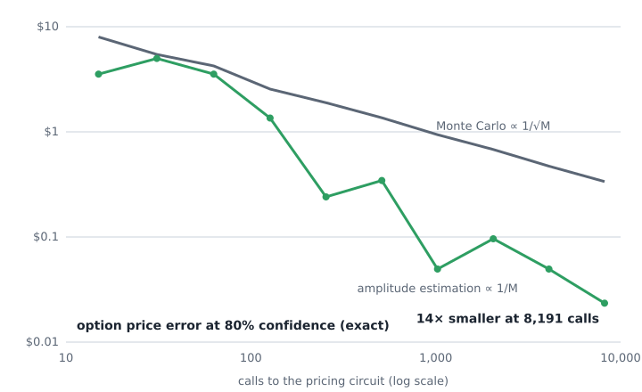

<div align="center">

# nano-qalgos

**The quantum algorithms industry talks about, from scratch. One NumPy file, every answer checked against exact math.**

[](https://github.com/nakka1/nano-qalgos/actions/workflows/ci.yml)


[](https://nakka1.github.io/nano-qalgos/)



QFT · phase estimation · Grover · Shor · VQE · QAOA · amplitude estimation

</div>

## Run it

```bash
pip install git+https://github.com/nakka1/nano-qalgos
nanoqalgos
```

That is the whole setup. No account, no API key, no quantum SDK. Other ways in:

| | |
|---|---|
| **Browser, zero install** | [nakka1.github.io/nano-qalgos](https://nakka1.github.io/nano-qalgos/) runs the same `nanoqalgos.py` in WebAssembly. Step through Grover, factor 35 with Shor, price an option. |
| **Docker** | `docker build -t nano-qalgos https://github.com/nakka1/nano-qalgos.git && docker run --rm -it nano-qalgos` |
| **Just read it** | `git clone` and open [`nanoqalgos.py`](nanoqalgos.py). It only needs `numpy`. |

## Check the math against the code

Every formula in this repository is tied to the exact lines that implement it, and to a test that proves they agree. A comment like `# [eq 3.2a]` in [`nanoqalgos.py`](nanoqalgos.py) marks the line that implements term **a** of equation 3.2. You can follow that link in three places, all generated from one registry ([`nanoqalgos_math.py`](nanoqalgos_math.py)):

| where | what you get |
|---|---|
| **Terminal** | `nanoqalgos verify` checks all 29 equations; `nanoqalgos verify 3.2` prints one equation, its terms, the highlighted code and the check. |
| **GitHub** | [MATH.md](MATH.md): rendered formulas with a letter under each term, a table of term → line links, the code, and the result. |
| **Browser** | [docs/math.html](https://nakka1.github.io/nano-qalgos/math.html): point at a term of the formula and its lines light up (and the reverse); re-run any check with new random inputs. |

```text
$ nanoqalgos verify 3.2
eq 3.2 · Diffusion is a reflection about |s⟩

    H⊗ⁿ (2|0⟩⟨0| − I) H⊗ⁿ = 2|s⟩⟨s| − I

  a  Hadamard on every qubit                              lines 160-161, 164-165
  b  − I: negate everything                               line 162
  c  2|0⟩⟨0|: restore |0⟩'s sign                          line 163

  nanoqalgos.py, nanoqalgos.diffusion()
      158  def diffusion(psi):
      159      n = psi.ndim
   a  160      for q in range(n):  # [eq 3.2a]
   a  161          psi = apply(psi, H, q)  # [eq 3.2a]
   b  162      psi = -psi  # [eq 3.2b]
   c  163      psi[(0,) * n] *= -1  # 2|0><0| - I [eq 3.2c, 3.3]
   a  164      for q in range(n):  # [eq 3.2a]
   a  165          psi = apply(psi, H, q)  # [eq 3.2a]
      166      return psi

  formula  [-0.058738+0.099841i, -0.023493+0.004142i, -0.129096+0.048732i, … 32 values]
  code     [-0.058738+0.099841i, -0.023493+0.004142i, -0.129096+0.048732i, … 32 values]
  ✓ max |formula − code| = 3.3e-16  (tolerance 1e-09)
```

The *formula* side of every check is the equation evaluated as written, with plain NumPy: matrix exponentials by diagonalization, sums written out, exact rationals for continued fractions, numerical integration for Black-Scholes. It never calls the function under test. And the link cannot rot: a test fails if a tag has no equation, if a term has no tagged line, or if MATH.md is out of date with the code.

## Why it matters, in numbers

Printed by `nanoqalgos bench` in under 3 seconds, and every "check" is also a test. Nothing here is sampled unless it says so: the simulator tracks every amplitude, and errors come from exact probability distributions.

| algorithm | problem | classical | quantum (simulated exactly) | check |
|---|---|---|---|---|
| QFT | 12 qubits | 16,777,216 matrix entries (DFT) | 84 gates | = `np.fft` to 6·10⁻¹⁷ |
| Grover | 1 of 65,536 items | 32,768.5 queries on average | **201 queries**, P = 0.99999 | = sin²((2k+1)θ) to 10⁻¹² |
| Shor | factor 15 | sub-exponential (GNFS) at scale | 12 qubits, P(success) = 0.50 per run | r = 4 → 3 × 5 |
| Shor | factor 21 | sub-exponential (GNFS) at scale | 15 qubits, P(success) = 0.33 per run | r = 6 → 3 × 7 |
| Shor | factor 35 | sub-exponential (GNFS) at scale | 18 qubits, P(success) = 0.33 per run | r = 12 → 5 × 7 |
| VQE | H₂ ground energy | exact diagonalization (2ⁿ × 2ⁿ) | 1,200 circuit runs | −1.137306 Ha, off by 7·10⁻⁶ mHa |
| QAOA | MaxCut, 3-regular cube | random cut: 0.5 of optimum | **0.6925** of optimum (p = 1) | = closed form to 2·10⁻¹⁵ |
| Amplitude est. | price a European call | Monte Carlo: ±0.4720 with 4,095 samples | **±0.0495** with 4,095 calls | MC needs ≈378,610 samples to match |

The last row is the one banks care about. Amplitude estimation reaches a given accuracy with quadratically fewer evaluations of the pricing model than Monte Carlo. Here is the whole curve, computed exactly:

<div align="center"></div>

The green line is a staircase, not a straight line, and that is real: the estimate lives on a grid of M angles, so the error depends on where the true angle falls between grid points. The guarantee (Brassard, Høyer, Mosca & Tapp, 2002) is about the envelope and holds at a fixed confidence of 8/π² ≈ 81%. A test checks it for every M from 8 to 1,024.

## Read it in this order

`nanoqalgos.py` is 441 lines, about 230 of them code. Each part ends in a number you can check, and each equation links to its page in [MATH.md](MATH.md).

| part | lines | equations | what you learn |
|---|---|---|---|
| [0 · Simulator](nanoqalgos.py#L33) | 33–87 | [0.1](MATH.md#eq-01) [0.2](MATH.md#eq-02) [0.3](MATH.md#eq-03) [0.4](MATH.md#eq-04) | A state is a tensor with one axis per qubit, and a gate is `np.tensordot` on those axes. That is a complete quantum computer, minus the speed. |
| [1 · QFT](nanoqalgos.py#L88) | 88–112 | [1.1](MATH.md#eq-11) [1.2](MATH.md#eq-12) [1.3](MATH.md#eq-13) | n(n+1)/2 gates do what an N×N matrix does, because the output is a product state. The test compares it with `np.fft`. |
| [2 · Phase estimation](nanoqalgos.py#L113) | 113–138 | [2.1](MATH.md#eq-21) [2.2](MATH.md#eq-22) [2.3](MATH.md#eq-23) | Turn an eigenvalue e^{2πiφ} into the binary digits of φ. The engine inside Shor and amplitude estimation. |
| [3 · Grover](nanoqalgos.py#L139) | 139–185 | [3.1](MATH.md#eq-31) [3.2](MATH.md#eq-32) [3.3](MATH.md#eq-33) [3.4](MATH.md#eq-34) | Two reflections make one rotation by 2θ. That geometry is the √N speedup, and the success probability is a closed form. |
| [4 · Shor](nanoqalgos.py#L186) | 186–254 | [4.1](MATH.md#eq-41) [4.2](MATH.md#eq-42) [4.3](MATH.md#eq-43) | Factoring reduces to finding a period; the period is a phase; continued fractions turn the measured phase back into an integer. |
| [5 · VQE](nanoqalgos.py#L255) | 255–320 | [5.1](MATH.md#eq-51) [5.2](MATH.md#eq-52) [5.3](MATH.md#eq-53) | A Hamiltonian is a weighted sum of Pauli strings. Exact gradients come from the parameter-shift rule, two circuit runs per parameter. |
| [6 · QAOA](nanoqalgos.py#L321) | 321–379 | [6.1](MATH.md#eq-61) [6.2](MATH.md#eq-62) [6.3](MATH.md#eq-63) | Optimization as alternating "cost" and "mix" evolutions. At one layer, the expected cut has a closed form; the simulator matches it to 10⁻¹⁵. |
| [7 · Amplitude estimation](nanoqalgos.py#L380) | 380–441 | [7.1](MATH.md#eq-71) [7.2](MATH.md#eq-72) [7.3](MATH.md#eq-73) [7.4](MATH.md#eq-74) [7.5](MATH.md#eq-75) [7.6](MATH.md#eq-76) | Load a price into one amplitude, rotate with Grover's operator, read the angle with phase estimation. With the fine print. |

## The math on one screen

**QFT** (eq 1.1–1.2). On $N = 2^n$ amplitudes,

$$\mathrm{QFT}\,|j\rangle = \frac{1}{\sqrt N}\sum_{k=0}^{N-1} e^{2\pi i\,jk/N}\,|k\rangle ,$$

and the output is $\bigotimes_{\ell}\big(|0\rangle + e^{2\pi i\, j/2^{\ell}}|1\rangle\big)/\sqrt2$: one Hadamard and a few controlled phases per qubit.

**Phase estimation** (eq 2.1–2.3). Controlled powers of $U$ build $\tfrac{1}{\sqrt M}\sum_k e^{2\pi i\varphi k}|k\rangle$, which is $\mathrm{QFT}|y\rangle$ when $\varphi = y/M$. Otherwise

$$P(y) = \Big|\tfrac{1}{M}\sum_{k=0}^{M-1} e^{2\pi i k(\varphi - y/M)}\Big|^2 \;\ge\; 4/\pi^2 \text{ at the nearest } y .$$

**Grover** (eq 3.4). With $\sin\theta = \sqrt{m/N}$, every oracle-plus-diffusion round rotates by $2\theta$:

$$P_{\text{success}}(k) = \sin^2\!\big((2k+1)\theta\big), \qquad k^\star \approx \tfrac{\pi}{4}\sqrt{N/m}.$$

**Shor** (eq 4.1–4.3). $U|y\rangle = |a y \bmod N\rangle$ has eigenvalues $e^{2\pi i s/r}$. Phase estimation returns $y \approx (s/r)\,2^t$; the continued fraction of $y/2^t$ recovers $r$; then $\gcd(a^{r/2}\pm1, N)$ are factors.

**VQE** (eq 5.2). For a gate $e^{-i\theta G/2}$ with $G^2 = I$, the derivative is exact, not a finite difference:

$$\frac{\partial E}{\partial\theta} = \tfrac12\Big[E\big(\theta+\tfrac{\pi}{2}\big) - E\big(\theta-\tfrac{\pi}{2}\big)\Big].$$

**QAOA** (eq 6.3). For MaxCut at $p = 1$, each edge $(u,v)$ contributes (Wang, Hadfield, Jiang & Rieffel, 2018)

$$\tfrac12 + \tfrac14\sin 4\beta\,\sin\gamma\,(\cos^{d}\gamma + \cos^{e}\gamma) - \tfrac14\sin^2 2\beta\,\cos^{d+e-2f}\gamma\,(1-\cos^{f}2\gamma),$$

with $d, e$ the other neighbours of $u, v$ and $f$ the triangles on the edge.

**Amplitude estimation** (eq 7.5). With $a = \sin^2\theta_a$ and $M$ grid points, with probability at least $8/\pi^2$

$$|\tilde a - a| \le \frac{2\pi\sqrt{a(1-a)}}{M} + \frac{\pi^2}{M^2}\quad\text{vs. Monte Carlo's}\quad \sqrt{a(1-a)/M}.$$

## Use it as a library

```python
import nanoqalgos as q

q.shor(21)                                   # -> ((3, 7), a, r, attempts)
psi, theta = q.grover(10, marked=[42])       # 25 queries on 1,024 items
q.probabilities(psi)[42]                     # -> 0.99946
theta, energies = q.vqe(q.H2)                # energies[-1] -> -1.857275 Ha (electronic)
q.qaoa_maxcut(4, [(0,1), (1,2), (2,3), (3,0)])   # -> (γ, β, expected cut 3.0 of 4)

p, f, scale, black_scholes = q.european_call()
est, probs, a = q.amplitude_estimation(p, f, t=9)
scale * a                                    # -> 7.9868 (Black-Scholes: 8.0214)
scale * q.error_at_confidence(est, probs, a) # -> 0.0495
```

In the terminal: `nanoqalgos demo`, `nanoqalgos bench`, `nanoqalgos shor 35` (every measurement peak, explained) and `nanoqalgos grover 5` (amplitudes round by round).

## What this is not

It is a textbook you can run, not a research tool, and it is honest about three things.

- **Everything is exact and noiseless.** Expectations in VQE and QAOA are computed from the state, not estimated from shots. A real device adds shot noise and gate errors; the companion repo [nano-quantum](https://github.com/nakka1/nano-quantum) shows how error correction fights the second one.
- **Simulation is exponential.** Shor for N = 35 needs 18 qubits and 2¹⁸ amplitudes, which is why factoring a real RSA key is far beyond any classical simulator and needs a large fault-tolerant machine.
- **The finance example is small.** Sixteen price points, and canonical amplitude estimation. Production methods (iterative or maximum-likelihood QAE) avoid the phase-estimation register; the advantage also depends on loading the distribution efficiently, which this file does with one exact unitary.

For real work, use Qiskit, Cirq or PennyLane. Reading this file first will make them much less mysterious.

## Exercises

Each is a natural next 30–100 lines, and a good first pull request.

1. **Add shot noise.** Estimate VQE energies from sampled measurements and watch how many shots chemical accuracy needs.
2. **Go deeper with QAOA.** Implement parameter-shift gradients for p ≥ 2 and see the cube ratio climb past 0.6924.
3. **Iterative amplitude estimation.** Replace the phase-estimation register with Grover powers and a classical estimator.
4. **Grover with an unknown count.** Search without knowing how many items are marked (exponential search over k).
5. **HHL.** Solve a 2×2 linear system with phase estimation plus a controlled rotation, and compare with `np.linalg.solve`.

## Repository

```
nanoqalgos.py           the algorithms: read this
nanoqalgos_math.py      the 29 equations, each tied to its lines and checked against them
MATH.md                 the same, rendered for GitHub (generated)
nanoqalgos_cli.py       `nanoqalgos demo | bench | verify | shor N | grover n`
tests/                  every claim in this README, as a test (pytest -q)
docs/index.html         browser demo (Pyodide), deployed by .github/workflows/pages.yml
docs/math.html          the math next to the code, interactive
scripts/make_assets.py  regenerates assets/ from nanoqalgos.py
Dockerfile              python:3.12-slim + numpy, runs the demo
```

Develop with `pip install -e ".[dev]" && pytest -q`. To publish the browser demo on your fork, set **Settings → Pages → Source** to **GitHub Actions**.

## Credits

Structure and spirit borrowed from Andrej Karpathy's [nanoGPT](https://github.com/karpathy/nanoGPT). The algorithms are the classics: Shor (1994), Grover (1996), Kitaev's phase estimation (1995), Peruzzo et al.'s VQE (2014), Farhi, Goldstone & Gutmann's QAOA (2014), and Brassard, Høyer, Mosca & Tapp's amplitude estimation (2002).

MIT © Alexandre O. S. Santos
